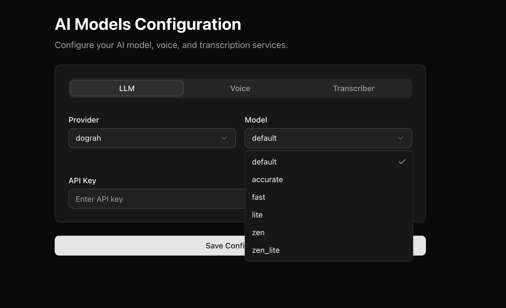
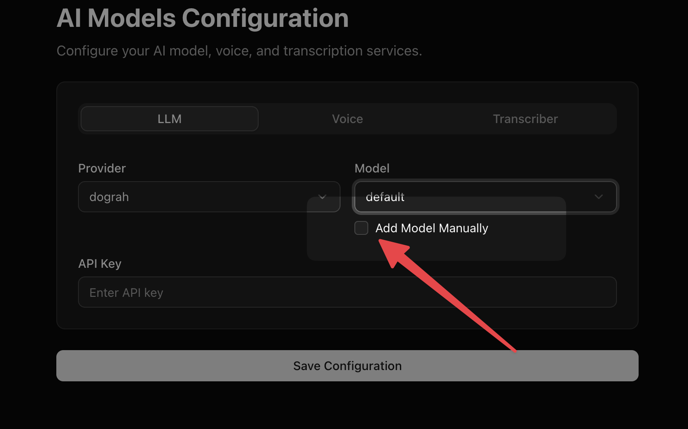

Dograh platform supports OpenAI, Google AI Studio, Google Vertex AI, Azure OpenAI, AWS Bedrock, Groq, OpenRouter, Hugging Face, MiniMax, Sarvam, and Dograh-managed LLMs. There are some models provided by default for you to choose from the drop down. 

<Warning>
LLM providers receive the data needed to generate responses, such as prompts, conversation history, model settings, and any configured tool/function definitions or tool call context. Review the provider's data processing, retention, model training, and regional hosting policies before using sensitive data.
</Warning>

For locally deployed or self-hosted LLMs, Dograh also supports OpenAI-compatible endpoints such as Ollama and vLLM.

## Dual-LLM Architecture: Conversational LLM vs. Intelligence LLM

In production, voice agents run both real-time voice conversations and asynchronous background text analysis. Dograh decouples these into two specialized models under **Model Configuration** and **Workflow Settings → Model Overrides**:

### 1. Conversational LLM
Dedicated exclusively to real-time speech dialogue with the caller.
* Optimized for low time-to-first-token (TTFT) and natural conversational pacing.
* Recommended: Low-latency voice-tuned models, OpenAI GPT-4o variants, or Sarvam (for Indic / Hinglish telephony).

### 2. Dedicated Intelligence & Extraction LLM
Dedicated to background data processing, context window management, and quality assurance:
* **Node-Level Variable Extraction:** Extracts structured entities (`string`, `number`, `boolean`) into `gathered_context` as callers answer questions.
* **Context Compaction:** Automatically summarizes older turns in the background when message history exceeds 6 turns.
* **Post-Call Intelligence (PCI):** Reads the completed transcript after hangup and extracts your configured CRM JSON schema into `extracted_data`.
* **QA Analysis Node:** Runs post-call grading, scoring (1–10), sentiment analysis, and compliance tagging into `annotations`.

<Tip>
Using a high-speed, cost-effective model (such as Groq `llama-3.3-70b-versatile`, OpenAI `gpt-4o-mini`, or Google `gemini-1.5-flash`) for the Intelligence LLM ensures background extractions complete in under 250ms with zero interference to caller speech or conversational token quota.
</Tip>

If you don't find a model in the drop down, you can always add a model manually.

