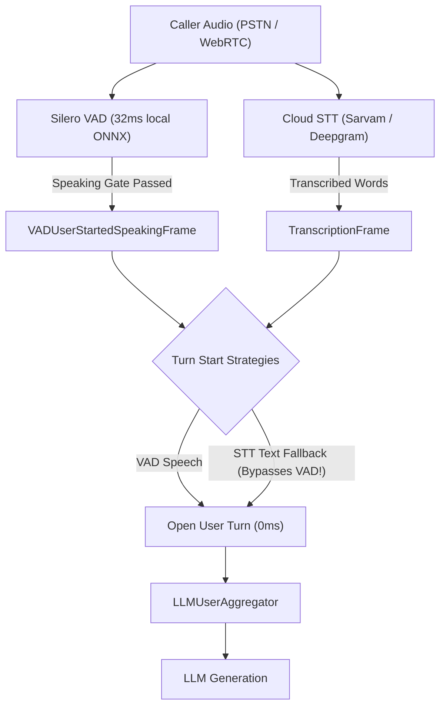

# Production Specification: Toggleable STT Transcription Fallback (`allow_transcription_fallback`)

## Executive Summary
In Talkar's current voice pipeline, whenever speech-to-text (STT) services like Sarvam or Deepgram produce transcriptions, a built-in fallback (`TranscriptionUserTurnStartStrategy` in `default`, and transcript listeners in `min_words` and `provisional_vad`) automatically opens the user turn even if local **Silero VAD** did not detect human speech (e.g. when `vad_min_volume` or `vad_confidence` is high).

While intended as a safety net for quiet whisperers, this fallback causes serious telephony issues:
1. **Defeats High VAD Noise Filters:** Background chatter, distant TVs, and line static that Silero VAD correctly rejected still wake up the bot if STT transcribes background words.
2. **Ghost Responses:** Delayed STT transcripts arriving 3–5 seconds after a user utterance trigger delayed turn starts, causing the bot to interrupt or answer phantom speech out of nowhere.
3. **Loss of Determinism:** Telephony administrators cannot enforce strict acoustic isolation.

This specification defines a production-ready, fully backward-compatible feature: **`allow_transcription_fallback: bool`** (default: `true`), configurable via Agent Settings under **Advanced Acoustic Controls (Silero VAD & Watchdog)**.

---

## 1. Architecture & Pipeline Mechanics

### 1.1 The Current Pipeline Flow


### 1.2 The New Architecture (Strict Acoustic Isolation Mode)
When `allow_transcription_fallback = false`:
```mermaid
flowchart TD
    AudioIn["Caller Audio"] --> STT["Cloud STT (Sarvam / Deepgram)"]
    AudioIn --> SileroVAD["Silero VAD (32ms local ONNX)"]
    
    SileroVAD -->|Speaking Gate Passed| VADStart["VADUserStartedSpeakingFrame"]
    STT -->|Transcribed Words| STTFrame["TranscriptionFrame"]
    
    VADStart --> TurnStart["Turn Start Strategies"]
    TurnStart --> UserTurnOpen["Open User Turn"]
    
    STTFrame --> FallbackCheck{"allow_transcription_fallback?"}
    FallbackCheck -->|true| TurnStart
    FallbackCheck -->|false| MuteCheck{"Is User Turn Active?"}
    
    MuteCheck -->|Active (VAD opened)| BufferText["Buffer Text for LLM"]
    MuteCheck -->|Inactive (VAD quiet)| DropText["Silently Drop Transcript\n(Ignore Background Chatter)"]
```

---

## 2. Comprehensive Strategy Behaviors

### 2.1 Strategy Matrix Under `allow_transcription_fallback`

| Turn Start Strategy | `allow_transcription_fallback: true` (Default) | `allow_transcription_fallback: false` (Strict Acoustic Mode) |
| :--- | :--- | :--- |
| **`default`** | Installs `[TranscriptionUserTurnStartStrategy(), VADUserTurnStartStrategy()]`. Transcript can open turn if VAD fails. | Installs **`[VADUserTurnStartStrategy()]` ONLY**. Incoming transcripts when VAD is quiet are strictly discarded. Turn opens **only** on Silero VAD. |
| **`min_words`** | When bot is silent, VAD opens at 0ms. If VAD fails, STT transcript opens turn. When bot is speaking, STT text interrupts after N words. | When bot is silent, **ONLY VAD opens the turn**. If VAD is quiet, STT transcripts are ignored. When bot is speaking, STT text interrupts **only if VAD also detected speech activity**. |
| **`provisional_vad`** | When bot is silent, transcript opens turn even if VAD quiet. When bot is speaking, pauses audio and waits for transcript. | When bot is silent, **ONLY VAD opens the turn**. When bot is speaking, VAD pauses audio, and transcript confirms interruption. Transcripts arriving without prior VAD pause are ignored. |
| **External STT Turns** *(Deepgram Flux / Cartesia `ink-2`)* | STT emits native `UserStartedSpeakingFrame`. | STT owns turn boundaries natively; `allow_transcription_fallback` has no effect (and is disabled/hidden in UI with clear tooltip). |

---

## 3. Detailed Edge Case Analysis & Solutions

### Edge Case 1: Stale / Delayed Transcript Arrives Just After VAD Closes the Turn
* **Scenario:** User says *"Yes"*, VAD opens turn, user pauses, VAD triggers `VADUserStoppedSpeakingFrame`, and the turn closes. 200–500ms later, a delayed STT transcript fragment arrives over WebSocket.
* **Risk:** In `allow_transcription_fallback: true`, that trailing fragment immediately reopens a brand-new phantom user turn.
* **Resolution in Strict Mode:** Because VAD is already in `VADState.QUIET` and the turn has closed, the trailing transcript cannot reopen a turn.

### Edge Case 2: Soft Affirmations (*"haan"*, *"ji"*) Below VAD Floor
* **Scenario:** The caller speaks an extremely faint *"haan"* that falls below `vad_min_volume: 0.35`. Sarvam STT transcribes it, but Silero VAD reports `QUIET`.
* **Behavior with `allow_transcription_fallback: false`:** The bot will **not** react to the faint *"haan"*.
* **Safeguard / UI Warning:** The UI setting explicitly documents:
  > *"When disabled, whispers and quiet affirmations below your Volume Floor will be ignored. If callers are often soft-spoken, ensure Volume Floor is set between 0.20–0.25 before turning this off."*

### Edge Case 3: Loud Background TV / Radio with High VAD Threshold
* **Scenario:** A television in the room speaks clear English or Hindi sentences.
* **Behavior with `allow_transcription_fallback: false`:** Because the TV is in the room background (below handset volume floor `0.35`), Silero VAD rejects it. Sarvam STT transcribes the TV speech, but the pipeline drops the frames. **The bot does not interrupt and does not respond to the TV.**

### Edge Case 4: Mid-Call Node Transitions & Teardown Race Conditions
* **Scenario:** A workflow transitions between nodes (`Start Call` $\rightarrow$ `Reservation Desk`).
* **Behavior:** `allow_transcription_fallback` is a workflow-level setting configured in `workflow_configurations`. It remains active across all nodes and does not cause race conditions during node transitions.

### Edge Case 5: Leftover Background Transcript Stored in Aggregator Buffer
* **Scenario:** In `LLMUserAggregator`, `_handle_transcription` accumulates text into `self._aggregation`. If background noise is transcribed while the turn is inactive, does it sit in memory and get glued to the user's next real spoken sentence?
* **Risk:** The caller says nothing (background TV plays: *"Breaking news"*). Later, the caller says *"I want a room"*. If the buffer isn't reset, the LLM receives: *"Breaking news I want a room"*.
* **Resolution:** When `has_active_user_turn` is `False` and `allow_transcription_fallback` is `False`, uninvited `TranscriptionFrame`s must NOT append to `_aggregation` in `LLMUserAggregator`, or `trigger_reset_aggregation()` must be called to purge discarded background text.

### Edge Case 6: User Idle Timeout (Watchdog Reprompt) Reset
* **Scenario:** The bot finishes speaking and asks a question. The user stays silent for 5 seconds. In the background, distant chatter is transcribed by STT.
* **Risk:** If `UserTurnController._handle_transcription` receives the transcript, it calls `self._user_turn_stop_timeout_event.set()`. If STT resets the idle watchdog, the bot will NEVER reprompt the user (*"Are you still there?"*) because continuous background noise keeps resetting the timer!
* **Resolution:** In Strict Acoustic Mode, because the transcript is not allowed to initiate a turn or register as user activity when VAD is quiet, it must NOT reset the idle timer. The watchdog reprompt fires accurately based on true user silence.

### Edge Case 7: VAD Speech-Start Jitter / High False Stop (`vad_stop_secs`)
* **Scenario:** A caller speaks with hesitation: *"I want... [0.4s pause] ...a double room"*. If `vad_stop_secs` is low (`0.25s`), VAD may emit `VADUserStoppedSpeakingFrame` during the pause.
* **Resolution:** Handled gracefully by `SpeechTimeoutUserTurnStopStrategy`, which maintains `user_speech_timeout` (0.75s–2.0s) as a policy floor before declaring the turn finished. If the user resumes speaking within the timeout, VAD emits `VADUserStartedSpeakingFrame` and continues the same turn seamlessly without needing text fallback.

### Edge Case 8: Interruption Behavior while Bot is Speaking
* **Scenario:** The bot is reciting a long greeting. A loud cough or ambient thud occurs, or a background person speaks.
* **Behavior with `allow_transcription_fallback: true`:** If STT transcribed any sound or words, the bot gets cut off mid-sentence.
* **Behavior with `allow_transcription_fallback: false`:** Interruption is strictly gated on the caller's physical voice overcoming the `vad_min_volume` and `vad_confidence` thresholds. Background murmurs will NOT cut off the bot.

### Edge Case 9: In-Memory Transcript Logs & Dashboard UI History
* **Scenario:** Telephony administrators review call logs on the Talkar dashboard to see what happened on a call.
* **Question:** If the caller did not speak, but the background TV produced words that were dropped by the pipeline, should those ghost words appear in the caller's conversation transcript on the dashboard?
* **Resolution:** No. Because the turn was never opened, no user turn was committed to the `LLMContext` or emitted via `on_user_turn_message_added`. The call transcript stays clean, containing only legitimate conversational turns between the caller and the bot.

### Edge Case 10: Call Recording Audio vs. Pipeline Transcript
* **Scenario:** Stereo call recording (Twilio / Plivo / Exotel / LiveKit) records the raw caller audio stream onto the caller track.
* **Behavior:** The raw caller audio track in the recording will still contain the acoustic background sound (e.g. ambient office chatter). However, the agent's turn engine and transcript strictly disregard it. This is standard telephony behavior: the audio recording preserves the physical line reality, while the agent's brain remains insulated from acoustic noise.

---

## 4. API & Data Schema Changes

### 4.1 Backend Schema (`workflow_configurations.py`)
```python
DEFAULT_ALLOW_TRANSCRIPTION_FALLBACK: bool = True

class WorkflowConfigurationDefaults(BaseModel):
    # Existing fields...
    vad_min_volume: float = Field(default=DEFAULT_VAD_MIN_VOLUME, ...)
    vad_confidence: float = Field(default=DEFAULT_VAD_CONFIDENCE, ...)
    vad_stop_secs: float = Field(default=DEFAULT_VAD_STOP_SECS, ...)
    user_turn_stop_timeout: float = Field(default=DEFAULT_USER_TURN_STOP_TIMEOUT, ...)
    turn_silence_timeout_secs: float = Field(default=DEFAULT_TURN_SILENCE_TIMEOUT_SECS, ...)
    
    # New Field:
    allow_transcription_fallback: bool = Field(
        default=DEFAULT_ALLOW_TRANSCRIPTION_FALLBACK,
        description="When true, allows speech-to-text transcriptions to start user turns if Silero VAD missed speech onset. When false, user turns can only start from local acoustic VAD detection.",
    )
```

### 4.2 Pipeline Implementation Details

#### 1. `run_pipeline.py` Strategy Factory
In `api/services/pipecat/run_pipeline.py`:
```python
def _create_non_realtime_user_turn_start_strategies(
    run_configs: dict, *, uses_external_turns: bool
):
    """Return user turn start strategies for non-realtime pipelines."""
    turn_start_strategy = run_configs.get(
        "turn_start_strategy", DEFAULT_TURN_START_STRATEGY
    )
    allow_transcription_fallback = run_configs.get(
        "allow_transcription_fallback", DEFAULT_ALLOW_TRANSCRIPTION_FALLBACK
    )

    if turn_start_strategy == "min_words":
        return [
            MinWordsUserTurnStartStrategy(
                min_words=_resolve_turn_start_min_words(run_configs),
                allow_transcription_fallback=allow_transcription_fallback,
            )
        ]

    if turn_start_strategy == "provisional_vad":
        return [
            ProvisionalVADUserTurnStartStrategy(
                pause_secs=_resolve_provisional_vad_pause_secs(run_configs),
                allow_transcription_fallback=allow_transcription_fallback,
            )
        ]

    if uses_external_turns:
        return [ExternalUserTurnStartStrategy(enable_interruptions=True)]

    # Default turn start strategy:
    if allow_transcription_fallback:
        # Standard fallback mode: either STT transcription or local VAD can open turn
        return [TranscriptionUserTurnStartStrategy(), VADUserTurnStartStrategy()]
    else:
        # Strict Acoustic Mode: Silero VAD is the sole gatekeeper!
        return [VADUserTurnStartStrategy()]
```

#### 2. MinWords & ProvisionalVAD Strategy Handlers
* **`MinWordsUserTurnStartStrategy` (`min_words_user_turn_start_strategy.py`)**:
  When `allow_transcription_fallback=False` and `not self._bot_speaking`:
  If a `TranscriptionFrame` arrives without prior VAD detection, it drops the frame instead of triggering turn start with 1 word.
* **`ProvisionalVADUserTurnStartStrategy` (`provisional_vad_user_turn_start_strategy.py`)**:
  When `allow_transcription_fallback=False` and `not self._provisional_pause_active` while the bot is speaking or quiet, transcripts that arrive without prior VAD triggers are discarded.
* **`LLMUserAggregator` (`llm_response_universal.py`)**:
  When `allow_transcription_fallback=False` and no user turn is active (`not self._user_turn_controller.has_active_user_turn`), incoming `TranscriptionFrame` text is discarded so background noise does not accumulate in `self._aggregation`.

---

## 5. UI Design in Agent Settings (`page.tsx`)

### Location:
Inside **Workflow Settings -> General -> Turn Detection -> Advanced Acoustic Controls (Silero VAD & Watchdog)** (Collapsible).

### UI Layout:
```tsx
{/* Allow Transcription Fallback Switch */}
<div className="flex items-center justify-between rounded-lg border border-border p-3 bg-muted/20">
    <div className="space-y-0.5 pr-4">
        <div className="flex items-center gap-1.5">
            <Label htmlFor="allow_transcription_fallback" className="text-xs font-medium cursor-pointer">
                STT Transcription Fallback
            </Label>
            <Tooltip>
                <TooltipTrigger asChild>
                    <HelpCircle className="h-3.5 w-3.5 text-muted-foreground cursor-help" />
                </TooltipTrigger>
                <TooltipContent className="max-w-xs">
                    When enabled, if Silero VAD misses quiet speech, incoming speech-to-text words will still rescue and open the turn. When disabled (Strict Acoustic Mode), turns can ONLY be opened by physical Silero VAD detection, completely ignoring background chatter and ghost transcripts.
                </TooltipContent>
            </Tooltip>
        </div>
        <p className="text-[11px] text-muted-foreground">
            Allow speech-to-text to rescue missed turns if Silero VAD was silent.
        </p>
    </div>
    <Switch
        id="allow_transcription_fallback"
        checked={allowTranscriptionFallback}
        onCheckedChange={(checked) => setAllowTranscriptionFallback(checked)}
    />
</div>
```

---

## 6. Rollout & Testing Plan

1. **Phase 1 (Development & Unit Verification):**
   - Add field to schema and frontend types.
   - Update `run_pipeline.py` strategy builder to honor `allow_transcription_fallback`.
   - Update `MinWordsUserTurnStartStrategy` and `ProvisionalVADUserTurnStartStrategy` to accept `allow_transcription_fallback`.
2. **Phase 2 (A/B Isolation Testing on Live Workflows):**
   - Keep default as `true` (zero regression for existing workflows).
   - Turn `allow_transcription_fallback: false` on test agent (e.g. Clove Dental or Toshali Sands).
   - Run background noise / distant television tests and verify in Docker logs that `[DEBUG-TRACE: TURN]` does not start on background speech when VAD is quiet.
3. **Phase 3 (Production Promotion):**
   - Promote to production after 48 hours of call logs showing clean zero-ghost behavior.
