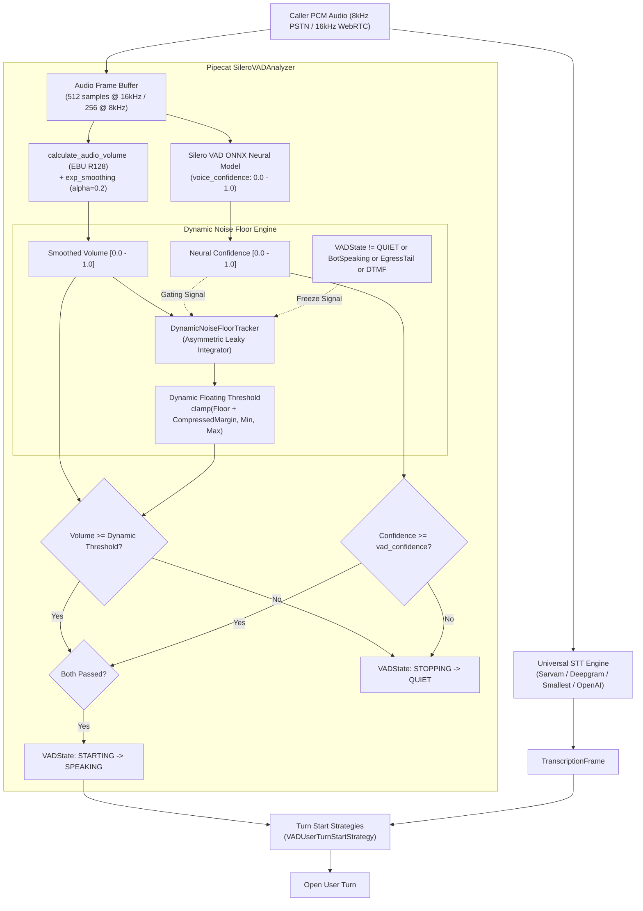

# Production Specification: Dynamic Noise Floor Baseline & Adaptive VAD (`dynamic_noise_floor`)

## Executive Summary
In Talkar's voice agent pipeline, Voice Activity Detection (VAD) evaluates whether incoming audio contains human speech using two gates in `SileroVADAnalyzer`:
1. **Neural Speech Confidence (`vad_confidence`):** Measures the probabilistic likelihood that audio frequencies contain human vocal tract resonance (default: `0.70`).
2. **Audio Loudness (`vad_min_volume`):** Measures smoothed EBU R128 normalized loudness on a scale of `[0.0, 1.0]` (default: `0.35`).

Currently, `vad_min_volume` is a **static threshold**. While simple, a fixed threshold creates two critical telephony failures:
* **The Whisper / Front-Clipping Problem (Quiet Environments):** In quiet rooms (ambient noise floor $\approx 0.02\text{–}0.05$), soft-spoken callers, quiet opening consonants (*"s"*, *"th"*, *"f"*), and whispered answers (*"yes"*, *"two"*) often peak at volume `0.20–0.30`. Because `0.25 < 0.35`, Silero VAD ignores the speech entirely.
* **The Noise Leak Problem (Loud Environments):** In a car with open windows, near a loud ceiling fan, or in a busy office, ambient background noise alone can sit at `0.28–0.33`. Any tiny non-speech sound (breath, chair squeak, clothes rustle) crosses `0.35`, triggering false turns and cutting off the AI agent.

This specification details a **fully backward-compatible, toggleable Dynamic Noise Floor Baseline system** (`dynamic_noise_floor`). It continuously tracks ambient noise energy during non-speech intervals and floats the volume threshold dynamically above the ambient floor:
$$\text{Threshold}_t = \text{clamp}\Big(\text{NoiseFloor}_t + \Delta_{\text{effective}}, \; \text{MinBound}, \; \text{MaxBound}\Big)$$

---

## 1. Architectural Positioning & Universal STT Compatibility

### 1.1 Where Dynamic VAD Sits in the Pipeline
The dynamic noise tracker operates at the **raw PCM audio layer** directly inside `SileroVADAnalyzer` (or its upstream frame feeder). It operates **before** speech frames reach turn start strategies and **completely independent of Cloud STT engines**.



### 1.2 Universal STT Provider Compatibility Matrix
Because this operates entirely inside local audio frame analysis, it requires **zero changes** to any STT provider implementation:

| STT Engine / Provider | Pipeline Mode | Compatibility | Behavior Under Dynamic Noise Floor |
| :--- | :--- | :--- | :--- |
| **Sarvam AI (`saaras:v4`)** | Cascade (Local VAD) | **100% Native** | Cleans speech gating; whisper turns are caught; background Hindi/Indic TV noise is rejected. |
| **Deepgram Nova-3** | Cascade (Local VAD) | **100% Native** | Protects STT from processing ambient silence frames; reduces unnecessary token costs. |
| **Smallest AI (`pulse`)** | Cascade (Local VAD) | **100% Native** | Eliminates false barge-ins on telephony PSTN trunks. |
| **Deepgram Flux / Cartesia** | External Turn EOT | **100% Native** | When cascade start strategies (`min_words` or `provisional_vad`) are active, dynamic VAD prevents unprovoked early interruptions. |
| **OpenAI / Gemini / Grok Realtime**| Provider Server VAD | **Isolated** | In native S2S mode, provider owns turns. In cascade tracking mode, dynamic VAD provides accurate local analytics. |

---

## 2. Mathematical Specification: Dual-Rate Asymmetric Adaptation

### 2.1 The Volume Metric Standard
To ensure mathematical consistency across all modules:
* Audio volume is calculated using Pipecat's **`calculate_audio_volume(audio, sample_rate)`** (EBU R128 loudness standard normalized to `[0.0, 1.0]`).
* Volume smoothing applies Pipecat's **`exp_smoothing(volume, prev_volume, factor=0.2)`**.
* The tracker consumes this smoothed volume float, guaranteeing exact alignment with the metric Silero VAD evaluates.

### 2.2 Dual-Rate Asymmetric Leaky Integration Formula
For each evaluated audio chunk $t$ (every $32\text{ms}$ at 16kHz, $32\text{ms}$ at 8kHz) with smoothed volume $V_t$:

#### Gating Condition (When to Adapt)
The baseline adapts **only** when audio is verified non-speech and no system activity can corrupt the floor:
$$\text{CanUpdate}_t = \big(\text{VADState}_t == \text{QUIET}\big) \land \big(\text{Confidence}_t < 0.20\big) \land (\neg \text{BotSpeaking}) \land (\neg \text{EgressTailActive}) \land (\neg \text{UserTurnActive}) \land (\neg \text{DTMFActive})$$

#### Asymmetric Leak Equations
When $\text{CanUpdate}_t$ is **True**:
1. **Decay Step (Room becomes quieter):**
   When $V_t < \text{NoiseFloor}_{t-1}$:
   $$\text{NoiseFloor}_t = (1 - \alpha_{\text{down}}) \cdot \text{NoiseFloor}_{t-1} + \alpha_{\text{down}} \cdot V_t$$
   * $\alpha_{\text{down}} = 0.05$ (Fast adaptation: converges to quiet conditions within $\approx 300\text{–}500\text{ms}$).
2. **Attack Step (Room becomes louder, fan turns on):**
   When $V_t \ge \text{NoiseFloor}_{t-1}$:
   $$\text{NoiseFloor}_t = (1 - \alpha_{\text{up}}) \cdot \text{NoiseFloor}_{t-1} + \alpha_{\text{up}} \cdot V_t$$
   * $\alpha_{\text{up}} = 0.003$ (Slow adaptation: requires $\approx 3.0\text{s}$ of sustained acoustic energy to raise the floor, completely filtering out transient coughs, claps, and door slams).

When $\text{CanUpdate}_t$ is **False**:
$$\text{NoiseFloor}_t = \text{NoiseFloor}_{t-1} \quad \text{(Frozen)}$$

### 2.3 Dynamic Margin Compression for Low-SNR Environments
In extremely noisy environments (e.g. ambient floor reaches `0.40`), adding a fixed margin of `0.15` would push the required speech volume to `0.55`, forcing the caller to shout.

To maintain natural conversational comfort, the margin scales dynamically as the noise floor increases:
$$\Delta_{\text{effective}} = \max\Big(0.08, \; \Delta_{\text{margin}} - 0.25 \cdot \max(0.0, \; \text{NoiseFloor}_t - 0.25)\Big)$$

* In a quiet bedroom ($\text{Floor} = 0.05$): Margin is full $\mathbf{0.15}$ $\rightarrow$ Threshold = $\mathbf{0.20}$.
* In a noisy office ($\text{Floor} = 0.35$): Margin gently compresses to $\mathbf{0.125}$ $\rightarrow$ Threshold = $\mathbf{0.475}$.
* In extreme road noise ($\text{Floor} = 0.45$): Margin compresses to $\mathbf{0.10}$ $\rightarrow$ Threshold = $\mathbf{0.55}$ (capped by `max_bound`).

#### Floating Cutoff with Hard Clamp Guardrails
$$\text{Threshold}_t = \min\Big(\text{MaxBound}, \; \max\big(\text{MinBound}, \; \text{NoiseFloor}_t + \Delta_{\text{effective}}\big)\Big)$$

---

## 3. Exhaustive Production Edge Cases & Solutions

### Edge Case 1: The Monologue Trap (Caller speaks for 30+ seconds)
* **Failure Mode:** If speech audio leaks into the noise floor tracker, a continuous caller speech stream (e.g. telling a long story or reciting an address) will cause the noise floor to creep upward toward vocal levels. Within 5–8 seconds, the dynamic threshold would exceed the caller's voice volume, cutting them off mid-sentence.
* **Production Solution:**
  1. Gating checks `VADState == QUIET`. During `STARTING`, `SPEAKING`, and `STOPPING` states, updates are strictly **frozen**.
  2. In addition, `Confidence < 0.20` acts as a neural pre-filter: even before the state machine transitions to `STARTING`, any audio with vocal resonance freezes adaptation.
  3. The noise floor remains pinned to the clean pre-speech baseline throughout the monologue.

### Edge Case 2: Transient Impulsive Noises (Cough, sneeze, keyboard clatter, door slam)
* **Failure Mode:** A single loud impulse (e.g. coughing at volume `0.65` for 200ms) could spike the baseline, deafening the agent to subsequent speech.
* **Production Solution:**
  * An impulse of $200\text{ms}$ contains only $\approx 6$ chunks of $32\text{ms}$.
  * With slow attack rate $\alpha_{\text{up}} = 0.003$:
    $$\Delta \text{Floor} \approx 6 \times (0.003 \times 0.65) \approx 0.011$$
  * A violent cough shifts the baseline by barely $0.01$, and fast decay ($\alpha_{\text{down}} = 0.05$) restores the clean floor within 2 chunks ($64\text{ms}$) after the cough ends.

### Edge Case 3: Initial Call Sniffing & Connect Transients (First 300ms)
* **Failure Mode:** The first 100ms of a WebRTC or SIP call often contains network jitter, comfort noise bursts, or click artifacts. If the floor is uninitialized, early speech could be missed or false-triggered.
* **Production Solution:**
  1. Seed initial baseline: $\text{NoiseFloor}_0 = \max(\text{MinBound} \times 0.5, \; 0.08)$.
  2. First $300\text{ms}$ Warm-up: The tracker runs a rapid warm-up mode ($\alpha = 0.20$) during the initial non-speech buffer to immediately snap to the line's real acoustic floor before the greeting plays.

### Edge Case 4: Acoustic Echo Bleed During Bot Playback (Speakerphone Calls)
* **Failure Mode:** On mobile speakerphone or car Bluetooth calls, the bot's own synthesized voice radiates from the speaker into the microphone. If the tracker samples this, it will measure the bot's voice as "background noise" and raise the threshold to `0.55`, preventing the user from interrupting the bot!
* **Production Solution:**
  * The tracker subscribes to `BotStartedSpeakingFrame` and `BotStoppedSpeakingFrame`.
  * Whenever the bot is speaking, noise floor adaptation is **completely frozen**.

### Edge Case 5: Audio Egress Playback Tail (Client Jitter Buffer Hold-off)
* **Failure Mode:** When the pipeline emits `BotStoppedSpeakingFrame`, audio frames have finished leaving the server, but the caller's mobile device or WebRTC browser is still draining its local jitter buffer for another $100\text{–}250\text{ms}$. If baseline tracking resumes instantly, the acoustic playback tail from the phone speaker will be sampled as ambient noise.
* **Production Solution:**
  * Added **`bot_tail_hold_secs` ($0.25\text{s}$)**.
  * When `BotStoppedSpeakingFrame` arrives, the tracker stays frozen for an additional $250\text{ms}$ to ensure the physical acoustic echo has completely dissipated from the caller's room before ambient tracking resumes.

### Edge Case 6: Digital Hardware Mute (Zero-Energy Tunnels)
* **Failure Mode:** When a caller presses "Mute" on their phone handset, digital audio drops to absolute zero (`0.0000`). If the tracker drops to `0.0000`, the threshold would drop to $\text{Margin} = 0.15$. When unmuted, the physical click could trigger speech.
* **Production Solution:**
  * Hard clamp $\text{MinBound} = 0.15$ ensures the threshold can never drop below a safe acoustic noise barrier, even in digital silence.

### Edge Case 7: Abrupt Noise Step Changes (Walking from Loud Street to Quiet Lobby)
* **Failure Mode:** Caller transitions between environments:
  * *Street to Lobby:* Noise drops from `0.35` to `0.05`. Fast decay ($\alpha_{\text{down}} = 0.05$) pulls the threshold down in $< 500\text{ms}$, immediately enabling soft indoor speech.
  * *Lobby to Street:* Noise jumps from `0.05` to `0.30`. The slow attack ensures that only continuous, sustained ambient roar raises the threshold, preventing false alarms.

### Edge Case 8: Interaction with `allow_transcription_fallback`
* **Harmony in Strict Acoustic Mode (`allow_transcription_fallback: false`):**
  * When fallback is disabled, only Silero VAD can start turns.
  * Dynamic Noise Floor makes this mode **substantially more robust**: because the volume threshold floats intelligently with the room, quiet callers are no longer missed, eliminating the primary reason users needed fallback in the first place!
* **Harmony in Fallback Mode (`allow_transcription_fallback: true`):**
  * Serves as an additional layer of defense: STT fallback only needs to intervene for extreme edge cases (e.g. whispering below `0.15`).

### Edge Case 9: Telephony Trunk Sample Rates (8kHz PSTN vs 16kHz WebRTC)
* **Failure Mode:** 8kHz PSTN chunks contain 256 samples ($32\text{ms}$) while 16kHz chunks contain 512 samples ($32\text{ms}$).
* **Production Solution:**
  * `calculate_audio_volume` takes `sample_rate` as an explicit argument and normalizes energy against sample count and int16 peak amplitude.
  * Time constants ($\alpha_{\text{up}}, \alpha_{\text{down}}$) are indexed to chunk evaluation frequency ($31.25\text{ chunks/sec}$), ensuring identical adaptation speeds on both cellular telephony and WebRTC.

### Edge Case 10: Thread Safety in Pipecat Architecture
* **Failure Mode:** `SileroVADAnalyzer` processes audio inside a dedicated `ThreadPoolExecutor(max_workers=1)` (`_run_analyzer`), while events like `bot_speaking` originate on the asyncio event loop.
* **Production Solution:**
  * State flags (`_bot_speaking`, `_user_turn_active`, `_bot_tail_until`) are synchronized using thread-safe atomic primitives or boolean attributes read synchronously inside `_run_analyzer`.

### Edge Case 11: In-Band Telephony DTMF Keypad Tones
* **Failure Mode:** When a caller presses a touch-tone button (DTMF) on a phone call, in-band audio generates high-energy pure sinusoids (`volume ~ 0.40–0.60`). Because pure sine waves lack human harmonic resonance, Silero neural confidence is near zero (`confidence < 0.10`).
* **The Trap:** Without an explicit check, a naive tracker would see `confidence < 0.20` and think *"This is loud ambient noise!"*, ratcheting the noise floor upwards during touch-tone entry!
* **Production Solution:**
  * If volume is high ($V_t > 0.35$) while confidence is near zero ($\text{Confidence} < 0.08$), the frame is flagged as an artificial tone.
  * Baseline adaptation is **frozen** during the tone.

### Edge Case 12: Cellular Discontinuous Transmission (DTX) & Comfort Noise (CNG)
* **Failure Mode:** Cellular carriers (VoLTE, 3G, 4G) frequently employ DTX. When the caller is silent, the cellular tower ceases sending audio RTP packets or periodically injects RFC 3389 Comfort Noise SID packets.
* **The Trap:** If packet flow stalls, time gaps between frames grow. If the tracker assumes a constant $32\text{ms}$ frame arrival, a sudden arrival of comfort noise could cause arithmetic jumps.
* **Production Solution:**
  * Frame processing checks elapsed wall-clock time $\Delta t$ between chunk evaluations.
  * If $\Delta t > 100\text{ms}$ (indicating a DTX pause or network gap), the tracker skips adaptation for the first arriving packet, preventing synthetic comfort noise bursts from corrupting the baseline.

### Edge Case 13: Mid-Call Node Handover & Context Persistence
* **Failure Mode:** In a multi-node conversation graph (`Start Call` $\rightarrow$ `Agent Node 1` $\rightarrow$ `Agent Node 2`), if the noise floor re-initialized on every node switch, the agent would lose its acoustic calibration mid-call.
* **Production Solution:**
  * The `DynamicNoiseFloorTracker` instance is **scoped strictly to the call session lifecycle**, instantiated once per call in `run_pipeline.py`.
  * Node transitions and graph edge traversal have **zero effect** on the continuous acoustic baseline.

### Edge Case 14: Prevention of "Hanging VAD" on Stop Decision
* **Failure Mode:** In noisy environments with static thresholds, callers often finish speaking, but background room noise ($0.32$) hovers right near the static cutoff ($0.35$). The VAD state machine gets stuck in `STOPPING` or oscillates, delaying the bot's response by 2–4 seconds until the safety watchdog expires.
* **Production Solution:**
  * Because the dynamic threshold actively floats above ambient noise ($\text{Threshold} = 0.42$), the moment the caller stops vocalizing, the smoothed volume drops decisively below the dynamic threshold.
  * This guarantees that the silence countdown (`vad_stop_secs`) starts immediately on speech cessation, delivering snappy, natural conversational turn handoffs without hanging.

### Edge Case 15: Extreme Audio Clipping & Mic Overdrive
* **Failure Mode:** When a caller shouts directly into a low-quality smartphone microphone, the analogue-to-digital converter clips, creating square waves and severe harmonic distortion.
* **Production Solution:**
  * The system clamps $V_t$ to `[0.0, 1.0]`. When audio is clipped, Silero VAD confidence remains high ($\approx 0.85\text{–}0.95$), triggering `SPEAKING` and freezing the baseline.
  * The tracker is completely shielded from clipped distortion energy.

### Edge Case 16: Ambient Background Audio (Comfort Noise Generator)
* **Failure Mode:** When Talkar's **Ambient Background Audio** is enabled (e.g. `office-ambience-8000-mono.wav` at volume `0.3`), could this synthetic loop pollute the noise floor tracker?
* **Production Solution:**
  * Talkar's ambient comfort sound is mixed exclusively on the **downstream egress transport track** sent to the telephone line.
  * It never enters the upstream audio pipeline, completely isolating the tracker from ambient comfort sound.

---

## 4. Configuration Schema & Backend Design

### 4.1 Schema Additions (`api/schemas/workflow_configurations.py`)
Fully backward-compatible definitions with production defaults:

```python
DEFAULT_DYNAMIC_NOISE_FLOOR = False
DEFAULT_DYNAMIC_NOISE_FLOOR_MARGIN = 0.15
DEFAULT_DYNAMIC_NOISE_FLOOR_MIN = 0.15
DEFAULT_DYNAMIC_NOISE_FLOOR_MAX = 0.55

class WorkflowConfigurationDefaults:
    # Existing defaults...
    DYNAMIC_NOISE_FLOOR = DEFAULT_DYNAMIC_NOISE_FLOOR
    DYNAMIC_NOISE_FLOOR_MARGIN = DEFAULT_DYNAMIC_NOISE_FLOOR_MARGIN
    DYNAMIC_NOISE_FLOOR_MIN = DEFAULT_DYNAMIC_NOISE_FLOOR_MIN
    DYNAMIC_NOISE_FLOOR_MAX = DEFAULT_DYNAMIC_NOISE_FLOOR_MAX

class WorkflowConfigurationsBase(BaseModel):
    # Static volume threshold (retained for backward compatibility and fallback)
    vad_min_volume: Optional[float] = Field(
        default=DEFAULT_VAD_MIN_VOLUME,
        ge=0.05,
        le=0.80,
        description="Static volume floor threshold (used when dynamic_noise_floor is false)."
    )
    
    # Toggleable Dynamic Noise Floor Baseline
    dynamic_noise_floor: Optional[bool] = Field(
        default=DEFAULT_DYNAMIC_NOISE_FLOOR,
        description="Enable dynamic noise floor tracking to auto-calibrate voice sensitivity to ambient room acoustics."
    )
    dynamic_noise_floor_margin: Optional[float] = Field(
        default=DEFAULT_DYNAMIC_NOISE_FLOOR_MARGIN,
        ge=0.05,
        le=0.35,
        description="Floating volume margin added above the measured ambient noise floor."
    )
    dynamic_noise_floor_min: Optional[float] = Field(
        default=DEFAULT_DYNAMIC_NOISE_FLOOR_MIN,
        ge=0.05,
        le=0.35,
        description="Minimum volume threshold clamp in quiet environments."
    )
    dynamic_noise_floor_max: Optional[float] = Field(
        default=DEFAULT_DYNAMIC_NOISE_FLOOR_MAX,
        ge=0.35,
        le=0.75,
        description="Maximum volume threshold clamp in noisy environments."
    )
```

### 4.2 Database Persistence
Workflow configurations in Talkar are stored in PostgreSQL within the `configurations` JSONB column. Adding these optional fields with defaults requires **zero database schema migrations** or table alterations, ensuring 100% backward compatibility for all existing workflow runs.

---

## 5. Pipeline Core Implementation & Lifecycle Wiring

### 5.1 The `DynamicNoiseFloorTracker` Module
File: `voice-agent/api/services/pipecat/dynamic_noise_floor.py`

```python
import time
from dataclasses import dataclass
from typing import TYPE_CHECKING
from loguru import logger

if TYPE_CHECKING:
    from pipecat.observers.turn_tracking_observer import TurnTrackingObserver

@dataclass
class DynamicNoiseFloorConfig:
    enabled: bool = False
    static_threshold: float = 0.35
    margin: float = 0.15
    min_bound: float = 0.15
    max_bound: float = 0.55
    alpha_up: float = 0.003
    alpha_down: float = 0.05
    bot_tail_hold_secs: float = 0.25

class DynamicNoiseFloorTracker:
    """Thread-safe adaptive noise floor tracker for Silero VAD analysis."""

    def __init__(self, config: DynamicNoiseFloorConfig):
        self.config = config
        self._noise_floor: float = max(config.min_bound * 0.5, 0.08)
        self._current_threshold: float = config.static_threshold
        self._bot_speaking: bool = False
        self._bot_tail_until: float = 0.0
        self._user_turn_active: bool = False
        self._dtmf_active: bool = False
        self._warmup_frames_remaining: int = 10  # ~300ms initial sniff
        self._last_frame_time: float = time.time()

    def attach_turn_tracking_observer(self, observer: "TurnTrackingObserver") -> None:
        """Subscribes to pipeline canonical turn events (mirrors TranscriptLogCoordinator)."""

        @observer.event_handler("on_bot_started_speaking")
        async def on_bot_started_speaking(_observer, turn_number: int, _data):
            self.set_bot_speaking(True)

        @observer.event_handler("on_bot_stopped_speaking")
        async def on_bot_stopped_speaking(_observer, turn_number: int, _data):
            self.set_bot_speaking(False)

        @observer.event_handler("on_turn_started")
        async def on_turn_started(_observer, turn_number: int):
            self.set_user_turn_active(True)

        @observer.event_handler("on_turn_ended")
        async def on_turn_ended(_observer, turn_number: int, _duration: float, was_interrupted: bool):
            self.set_user_turn_active(False)

    def set_bot_speaking(self, speaking: bool) -> None:
        """Updates bot speaking state and arms the egress buffer tail hold."""
        self._bot_speaking = speaking
        if not speaking:
            # Egress buffer drain hold: hold freeze for 250ms after bot audio finishes
            self._bot_tail_until = time.time() + self.config.bot_tail_hold_secs

    def set_user_turn_active(self, active: bool) -> None:
        """Updates user turn state."""
        self._user_turn_active = active

    def set_dtmf_active(self, active: bool) -> None:
        """Called when in-band DTMF key tones are active."""
        self._dtmf_active = active

    def update_and_get_threshold(
        self,
        smoothed_volume: float,
        confidence: float,
        vad_state_quiet: bool
    ) -> float:
        """Updates baseline if non-speech, and returns the effective volume threshold."""
        if not self.config.enabled:
            return self.config.static_threshold

        now = time.time()
        elapsed = now - self._last_frame_time
        self._last_frame_time = now

        # Skip adaptation on DTX resume after network silence gap (>100ms)
        if elapsed > 0.10:
            return self._current_threshold

        # Initial warm-up fast acquisition
        if self._warmup_frames_remaining > 0:
            self._warmup_frames_remaining -= 1
            self._noise_floor = 0.80 * self._noise_floor + 0.20 * smoothed_volume
            return self._calculate_clamped_threshold()

        # Check egress audio playback tail hold
        is_egress_tail_active = (now < self._bot_tail_until)

        # Reject pure sinusoidal tonal spikes (In-band DTMF or tone interference)
        is_synthetic_tone = (smoothed_volume > 0.35 and confidence < 0.08)

        # Check update eligibility (Frozen during speech, turns, DTMF, and bot playback/tail)
        can_update = (
            vad_state_quiet
            and (confidence < 0.20)
            and (not self._bot_speaking)
            and (not is_egress_tail_active)
            and (not self._user_turn_active)
            and (not self._dtmf_active)
            and (not is_synthetic_tone)
        )

        if can_update:
            if smoothed_volume < self._noise_floor:
                # Fast decay into quiet room
                self._noise_floor = (
                    (1.0 - self.config.alpha_down) * self._noise_floor
                    + self.config.alpha_down * smoothed_volume
                )
            else:
                # Slow attack against rising sustained noise
                self._noise_floor = (
                    (1.0 - self.config.alpha_up) * self._noise_floor
                    + self.config.alpha_up * smoothed_volume
                )

        return self._calculate_clamped_threshold()

    def _calculate_clamped_threshold(self) -> float:
        """Calculates floating threshold with dynamic margin compression and hard clamps."""
        # Dynamic margin compression in high noise floors (> 0.25)
        margin_compression = 0.25 * max(0.0, self._noise_floor - 0.25)
        effective_margin = max(0.08, self.config.margin - margin_compression)
        
        floating = self._noise_floor + effective_margin
        self._current_threshold = max(self.config.min_bound, min(self.config.max_bound, floating))
        return self._current_threshold

    @property
    def current_noise_floor(self) -> float:
        return self._noise_floor

    @property
    def current_threshold(self) -> float:
        return self._current_threshold if self.config.enabled else self.config.static_threshold
```

### 5.2 Integration in `run_pipeline.py`
In `api/services/pipecat/run_pipeline.py`:

```python
# 1. Resolve dynamic config in _resolve_vad_params:
dynamic_config = DynamicNoiseFloorConfig(
    enabled=bool(run_configs.get("dynamic_noise_floor", False)),
    static_threshold=float(run_configs.get("vad_min_volume", DEFAULT_VAD_MIN_VOLUME)),
    margin=float(run_configs.get("dynamic_noise_floor_margin", 0.15)),
    min_bound=float(run_configs.get("dynamic_noise_floor_min", 0.15)),
    max_bound=float(run_configs.get("dynamic_noise_floor_max", 0.55)),
)
dynamic_tracker = DynamicNoiseFloorTracker(dynamic_config)

# 2. Pass dynamic_tracker into SileroVADAnalyzer:
user_vad_analyzer = SileroVADAnalyzer(
    params=_resolve_vad_params(run_configs),
    dynamic_tracker=dynamic_tracker
)

# 3. Attach lifecycle observer alongside TranscriptLogCoordinator (line ~1310):
if task.turn_tracking_observer:
    dynamic_tracker.attach_turn_tracking_observer(task.turn_tracking_observer)
```

### 5.3 Integration in `vad_analyzer.py`
In `VADAnalyzer._run_analyzer`:

```python
# Before checking speaking condition:
if self._dynamic_tracker and self._dynamic_tracker.config.enabled:
    is_quiet_state = (self._vad_state == VADState.QUIET)
    effective_min_volume = self._dynamic_tracker.update_and_get_threshold(
        smoothed_volume=volume,
        confidence=confidence,
        vad_state_quiet=is_quiet_state,
    )
else:
    effective_min_volume = self._params.min_volume

speaking = confidence >= self._params.confidence and volume >= effective_min_volume
```

---

## 6. Frontend UI, TypeScript & Calibration Experience

### 6.1 Frontend TypeScript Types (`ui/src/types/workflow-configurations.ts`)
```typescript
export interface WorkflowConfigurations {
  // Existing fields...
  vad_min_volume?: number;
  vad_confidence?: number;
  vad_stop_secs?: number;
  allow_transcription_fallback?: boolean;

  // Dynamic Noise Floor
  dynamic_noise_floor?: boolean;
  dynamic_noise_floor_margin?: number;
  dynamic_noise_floor_min?: number;
  dynamic_noise_floor_max?: number;
}
```

### 6.2 Settings Page Card (`ui/src/app/workflow/[workflowId]/settings/page.tsx`)
In `ui/src/app/workflow/[workflowId]/settings/page.tsx`, `dynamicNoiseFloor` is added to local state and included in the `isDirty` `useMemo` dependency array:

```tsx
<div className="flex items-center justify-between p-4 border rounded-lg bg-card">
  <div className="space-y-0.5 max-w-[80%]">
    <div className="flex items-center gap-2">
      <Label className="text-sm font-medium">Dynamic Noise Floor Baseline</Label>
      <Badge variant="outline" className="text-xs font-normal text-emerald-600 border-emerald-500/30">
        Adaptive VAD
      </Badge>
    </div>
    <p className="text-xs text-muted-foreground">
      Continuously measures ambient room noise and floats the volume threshold. Enables soft speech and quiet affirmations in bedrooms while automatically rejecting loud fans, cars, and office chatter.
    </p>
  </div>
  <Switch
    checked={dynamicNoiseFloor}
    onCheckedChange={setDynamicNoiseFloor}
  />
</div>
```

### 6.3 Visualizer in `LiveVadTester.tsx`
* Renders a real-time floating indicator on the Volume meter labeled `Dynamic Threshold (Auto)`.
* When the user speaks, the baseline freezes; when background music or typing plays, the indicator floats smoothly upward, visually demonstrating that the ambient sound is being rejected.

---

## 7. Verification, Testing & QA Validation Plan

### 7.1 Unit Tests (`api/tests/test_dynamic_noise_floor.py`)
1. **`test_backward_compatibility_disabled`:** Verify that when `dynamic_noise_floor=False`, threshold returned equals `vad_min_volume` identically across 10,000 frames.
2. **`test_monologue_freeze`:** Simulate continuous speech for 1,000 frames ($32\text{s}$). Verify `noise_floor` does not increase by more than `0.005`.
3. **`test_fast_decay_on_silence`:** Transition from loud ambient noise ($0.40$) to quiet ($0.05$). Verify noise floor drops into quiet range in $< 500\text{ms}$.
4. **`test_slow_attack_on_spikes`:** Inject a 150ms spike at volume $0.80$. Verify baseline shift is $< 0.012$.
5. **`test_hard_clamps`:** Feed volume $0.00$ and $1.00$. Verify effective threshold is strictly clamped between `min_bound` ($0.15$) and `max_bound` ($0.55$).
6. **`test_bot_speaking_freeze`:** Verify that setting `bot_speaking=True` freezes baseline adaptation.
7. **`test_bot_tail_hold`:** Verify that after `bot_speaking=False`, baseline remains frozen for `bot_tail_hold_secs` ($250\text{ms}$).
8. **`test_inband_dtmf_freeze`:** Inject pure sinusoidal tone ($V = 0.50$, $\text{Confidence} = 0.02$). Verify baseline freezes.
9. **`test_margin_compression`:** When noise floor is $0.40$, verify margin compresses from $0.15$ to $\approx 0.11$, keeping threshold manageable for the caller.
10. **`test_observer_lifecycle_attachment`:** Verify that firing events on a mock `TurnTrackingObserver` updates `tracker._bot_speaking` and `tracker._user_turn_active` synchronously.

### 7.2 Telephony Integration Test (PSTN Call 8kHz)
* Place an outbound PSTN call using Sarvam STT.
* Background: Run a 70dB ceiling fan simulation.
* Verify: No false turn start triggered; when caller speaks, turn triggers cleanly on physical voice onset.
